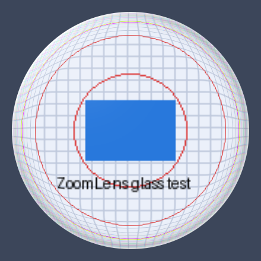

# Glassy

A tiny, fast, round screen magnifier for Windows with a **liquid glass** edge.
Press a hotkey, a glass lens follows your cursor, scroll the mouse wheel to zoom.


[](https://github.com/ridvanaslan0/glassy/actions/workflows/build.yml)
[](LICENSE)



*The lens edge, rendered by Glassy's own code from a synthetic test pattern.*

## Features

- **Round lens that follows the cursor** and never blocks clicks (click-through).
- **Liquid glass edge**: light refraction, chromatic aberration, a bright specular rim, a soft glint and an inner shadow.
- **Mouse wheel zoom** (1.25x to 20x) and **Shift + wheel** to resize the lens (150 to 900 px).
- **Global hotkey** `Ctrl+Alt+Z` to turn the lens on and off.
- **On-screen notification**: a small toast with a green or red dot says whether Glassy is ON or OFF.
- **Starts with Windows** (optional, enabled on first run, easy to turn off).
- **Never captures itself**: the lens is hidden from screen capture, so there is no lens-inside-lens effect on Windows 10 or 11. It does not appear in screenshots or recordings.
- **Settings window** and tray menu for lens size, zoom level and options. Settings are saved automatically.
- **Tiny and dependency-free**: one C file, about 40 KB, no runtime or installer needed.
- **Idle-friendly**: no CPU use while the lens is off, and almost none while nothing on screen changes.

## Install

1. Download `Glassy-vX.Y.Z-win-x64.zip` from the [Releases](https://github.com/ridvanaslan0/glassy/releases) page.
2. Extract it and run `Glassy.exe`. There is no installer.
3. Look for the Glassy icon in the system tray (it may be inside the `^` overflow menu).

Windows SmartScreen may warn about an unknown publisher because the executable is not code-signed. Choose **More info**, then **Run anyway**. You can also build it yourself, see below.

**Requirements:** Windows 10 version 2004 (build 19041) or later, or Windows 11, 64-bit. Older Windows 10 builds cannot hide the lens from screen capture, so Glassy shows a warning and the lens may appear inside itself there.

## Usage

| Action | How |
| --- | --- |
| Turn the lens on or off | `Ctrl+Alt+Z`, or left click the tray icon |
| Zoom in / out | Mouse wheel while the lens is on |
| Change lens size | `Shift` + mouse wheel while the lens is on |
| Open settings | Right click the tray icon, then **Settings...** |
| Quick lens size presets | Tray menu, then **Lens size** |
| Quit | Tray menu, then **Exit** |

While the lens is on, the mouse wheel is captured for zooming everywhere. If you would rather keep normal scrolling, enable **Zoom with the wheel only while Ctrl is held** in the settings.

### Settings

| Option | Default | Description |
| --- | --- | --- |
| Lens size | 400 px | Diameter of the lens |
| Zoom level | 2.5x | Magnification used when the lens opens |
| Run at Windows startup | On | Adds or removes a per-user startup entry (no admin rights needed) |
| Zoom with the wheel only while Ctrl is held | Off | Lets the wheel scroll normally unless Ctrl is pressed |

Settings live in the registry under `HKEY_CURRENT_USER\Software\Glassy`. To remove everything, turn off startup in the settings, exit Glassy, delete `Glassy.exe` and delete that registry key.

## How it works

Glassy is written in plain C against the Win32 API and runs three threads so that nothing can make your mouse feel slow:

- **Hook thread**: a low-level mouse hook that only reads wheel events. It never draws.
- **Lens thread**: grabs the area around the cursor, applies the liquid glass transform and updates a layered window in a single `UpdateLayeredWindow` call, paced by `DwmFlush` to your display refresh rate. If nothing changed, it skips the frame.
- **Main thread**: tray icon, hotkey, notification toast and the settings window.

The glass effect is built from lookup tables that are computed once per lens size. Each frame only samples the captured pixels (bilinear) and blends the precomputed highlights, so it stays fast on the CPU.

## Build from source

Glassy builds with MinGW-w64. No other dependencies.

**Linux or macOS (cross-compile) / MSYS2 shell:**

```bash
sudo apt install mingw-w64   # Debian/Ubuntu
./build.sh
```

**Windows (MSYS2 MinGW shell with `gcc` and `windres` on PATH):**

```bat
build.bat
```

The result is `build/Glassy.exe`. Pushing a tag such as `v1.0.0` makes GitHub Actions build the executable and attach it to a GitHub Release automatically, see [`.github/workflows/release.yml`](.github/workflows/release.yml).

## Project layout

```
src/glassy.c            all application code
resources/glassy.rc     version info and manifest resource
resources/glassy.manifest   DPI awareness and visual styles
build.sh, build.bat     build scripts
.github/workflows/      CI build and release automation
docs/                   images
release/                prebuilt Glassy.exe for convenience
```

## Known limitations

- The screen is captured with GDI, so some content (for example hardware-accelerated overlay video or protected DRM video) may appear black or stale inside the lens.
- Semi-transparent "layered" windows, such as some tooltips, do not appear inside the magnified view.
- Only the screen under the cursor area is magnified; the lens is not clamped to stay inside the screen edge.
- At the largest lens size (900 px) the frame rate can drop below 60 fps on slower CPUs.
- Exclusive-fullscreen games may draw over the lens.

## Troubleshooting

- **"The Ctrl+Alt+Z hotkey is already in use"**: another program owns that shortcut. Close it, or change `HOTKEY_MOD` and `HOTKEY_VK` at the top of `src/glassy.c` and rebuild.
- **The tray icon is missing**: check the `^` overflow area of the taskbar and drag the icon out to pin it.
- **The lens looks like an endless tunnel (lens inside lens)**: this means the lens is capturing itself. Glassy hides the lens from capture to prevent this, which needs Windows 10 version 2004 (build 19041) or later. Update Windows, or open an issue if it still happens.

## Contributing

Bug reports and pull requests are welcome, see [CONTRIBUTING.md](CONTRIBUTING.md).

## License

[MIT](LICENSE)
